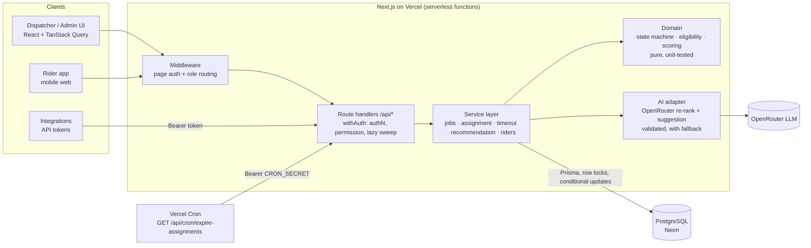
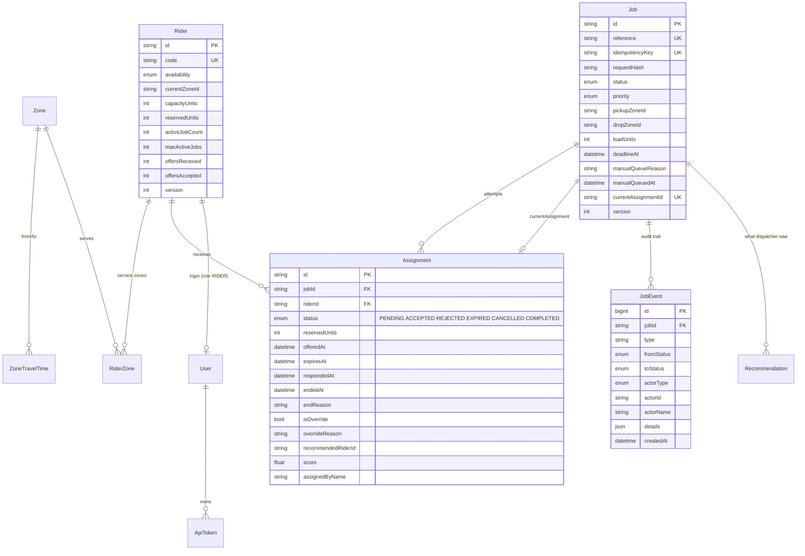
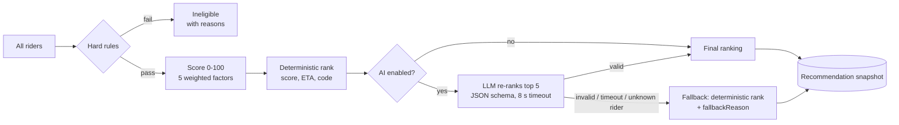

# RELAY: System Design

## 1. Goals and shape of the solution

RELAY is a dispatch desk for a small-to-medium operations team (tens of dispatchers, hundreds of riders, thousands of jobs a day). The design favours:

- **Correctness of the workflow over feature count.** A job is never assigned twice, never stuck, and never silently dropped. Capacity is never double-booked.
- **Explainability.** Every recommendation shows its factor breakdown, every override has a reason, and every change is in an append-only event log.
- **Operational simplicity.** It is one deployable (Next.js) plus one database (Postgres). There is no queue, worker fleet or cache to run. Timeouts work with or without the scheduler.

## 2. Architecture



| Layer | Responsibility | Key files |
| --- | --- | --- |
| UI | Dashboard, jobs, job detail with recommendations and timeline, Manual Queue, riders, rider app, settings, admin. Polls every 5 seconds. Handles loading, empty, error and stale states. | `src/app/(app)/**`, `src/app/rider/**`, `src/components/**` |
| Middleware | Redirects anonymous users to `/login`, keeps riders inside `/rider`, keeps `/admin` admin-only. API routes are not trusted to it. | `src/middleware.ts` |
| Route handlers | Thin: parse and validate (Zod), call one service, map errors to HTTP. Every handler is wrapped in `withAuth`, which a test enforces. | `src/app/api/**`, `src/auth/withAuth.ts`, `src/lib/http.ts` |
| Services | Transactions, locking, capacity reservation, event recording, timeout sweeps. Shared by the API, seed script and tests. | `src/services/**` |
| Domain | Pure functions: the job state machine, the eligibility rules, and the scoring and ranking. No I/O, so they are unit-tested directly. | `src/domain/**` |
| AI adapter | Builds prompts, calls OpenRouter with a JSON schema and timeout, validates the output, and falls back on any failure. | `src/ai/**` |
| Auth | Auth.js credentials and JWT sessions, hashed scoped API tokens, the role-to-permission map, login rate limiting, and the cron secret check. | `src/auth/**` |

### Why this stack

A single Next.js app gives one language end to end and one deployment target with free hosting (Vercel), plus a managed Postgres free tier (Neon). Postgres was chosen over a document store because the hardest requirements (no double assignment, no double-booked capacity, exactly-once timeouts, idempotent creation) map directly onto row locks, conditional updates, unique and partial indexes, and check constraints.

## 3. Data model



### Key modelling decisions

- **Job and Assignment are separate entities.** A job is the customer's delivery and has one lifecycle. An assignment is a single offer to a single rider, with its own outcome (`PENDING → ACCEPTED → COMPLETED`, or `REJECTED`, `EXPIRED`, `CANCELLED`). A job that times out twice and is then delivered has three assignment rows, and none of them is overwritten. `Job.currentAssignmentId` points at the live one.
- **The capacity reservation lives on the assignment.** `Assignment.reservedUnits` records exactly what was reserved, so the release on timeout, rejection, cancellation or delivery returns the same amount even if the job or rider changed in between. `Rider.reservedUnits` and `activeJobCount` are denormalized counters, kept consistent by changing them only in the same transaction as the assignment status.
- **The audit trail is append-only and separate** (`JobEvent`, with an autoincrement id so ordering is total). Events carry `from/to` status, actor type, id and name, and a JSON `details` payload for event-specific facts such as the score, the override reason, the threshold or the released units. History is never reconstructed from the current status.
- **The recommendation snapshot** (`Recommendation`) stores what the dispatcher was shown: strategy, top rider, candidate scores, AI output and fallback reason. Override detection compares the chosen rider with *that* snapshot rather than a recomputation that may have drifted. It also doubles as a short-lived cache.
- **Settings** is a single row: confirmation threshold (default 7200 seconds), simulated clock offset, and last sweep metadata.

### Constraints and indexes that protect business rules

| Mechanism | Protects |
| --- | --- |
| `UNIQUE (Job.reference)`, `UNIQUE (Job.idempotencyKey)` plus `requestHash` | A repeated or concurrent submission creates exactly one job, and a reused key with a different body is detected |
| `UNIQUE INDEX assignment_one_live_per_job ON Assignment(jobId) WHERE status IN ('PENDING','ACCEPTED')` | At most one live assignment per job, even if application code had a bug |
| `UNIQUE (Job.currentAssignmentId)` | An assignment can be current for only one job |
| `CHECK (reservedUnits BETWEEN 0 AND capacityUnits)`, `CHECK (activeJobCount BETWEEN 0 AND maxActiveJobs)` | Capacity can never be overbooked or go negative |
| `CHECK (loadUnits > 0)`, `CHECK (Assignment.reservedUnits > 0)` | Sane loads |
| `INDEX (status, expiresAt)` plus a partial index on pending expiries | The sweep finds due offers without scanning history |
| `INDEX (status, createdAt)`, `(status, pickupZoneId)`, `(status, manualQueuedAt)` | Dashboard counts, zone filters, and the Manual Queue sorted oldest first |
| `INDEX (jobId, id)` on JobEvent, `(jobId, createdAt)` on Assignment | Job timeline and attempt history in one index range scan |
| `INDEX (riderId, status)` | The rider app feed and the rider's live work |

## 4. Rider recommendation

Recommendation is **hybrid**: deterministic code decides *who may* take the job and produces an explainable baseline; the LLM only re-orders the top candidates and adds a predicted acceptance probability and a reason.



**Hard rules** (`src/domain/eligibility.ts`). The rider is `ONLINE`, services both the pickup and drop zones, has enough free capacity, is below their active job limit, and has not already rejected this job. The same rules are re-checked atomically in SQL when capacity is reserved.

**Score** (`src/domain/scoring.ts`). Points out of 100. The weights shift for `HIGH` and `URGENT` jobs toward speed.

| Factor | Normal | High/Urgent | Formula |
| --- | --: | --: | --- |
| Travel time to pickup | 35 | 45 | `1 - eta/60 min`, using the zone travel matrix (same zone 8 min, unknown pair 45 min) |
| Spare capacity after the job | 20 | 10 | `freeAfter / capacity`, which prefers riders who keep headroom |
| Workload | 20 | 15 | `1 - activeJobs / maxActiveJobs`, which balances load |
| Deadline fit | 15 | 20 | `slack / 60 min`, where `slack = minutesToDeadline - (eta + 5 min handling + pickup→drop)`. Zero, plus a warning, if the rider is likely to miss. |
| Reliability | 10 | 10 | Laplace-smoothed acceptance rate `(accepted + 1) / (offered + 2)` |

A rider who already let an offer for this job expire loses 10 points and gets a warning. Ties break by ETA, then rider code, so results are deterministic and testable. Each candidate's top three factors become its human-readable "reasons".

**AI re-rank** (`src/ai/reranker.ts`). The top 5 eligible candidates, with their factor breakdown, warnings and baseline acceptance probability, are sent to OpenRouter with a strict JSON schema. The model returns the order, `acceptProbability`, `etaMinutes`, a one-line reason per rider, a summary and an optional risk note. The output is **rejected in full** if it is malformed, names a rider outside the candidate list, or repeats a rider. Candidates the model skipped are appended in score order. The model can therefore never make an ineligible rider assignable; it can only change the order of riders who already qualify.

**Manual Queue suggestion** (`src/ai/suggest.ts`). Given the job, its attempt history and recent events, the model proposes `REASSIGN` (with a rider from the eligible list), `WAIT`, `CANCEL` or `ESCALATE`. Deterministic rules provide the same contract when the AI is unavailable. The suggestion is advisory; a dispatcher still clicks Assign.

## 5. Assignment and confirmation workflow

```mermaid
sequenceDiagram
  autonumber
  participant D as Dispatcher
  participant API as assignRider()
  participant DB as Postgres
  participant R as Rider

  D->>API: POST /jobs/{id}/assign {riderId, overrideReason?, expectedVersion?}
  API->>DB: BEGIN; SELECT job FOR UPDATE
  API->>DB: sweepJobLocked (expire this job's overdue offer, if any)
  API->>API: version check, state check, re-rank, eligibility, override rule
  API->>DB: UPDATE Rider SET reserved+=load ... WHERE ONLINE AND free>=load AND active<max
  alt 0 rows updated
    API-->>D: 409 RIDER_CAPACITY_CONFLICT
  end
  API->>DB: INSERT Assignment(PENDING, expiresAt = now + threshold)
  API->>DB: UPDATE Job SET status=AWAITING_CONFIRMATION, currentAssignmentId, version+1
  API->>DB: INSERT JobEvent RIDER_ASSIGNED (+ MANUAL_OVERRIDE); COMMIT
  API-->>D: 201
  R->>API: POST /assignments/{id}/accept
  API->>DB: BEGIN; lock job; sweepJobLocked
  alt offer already overdue
    API->>DB: EXPIRE + release + MANUAL_QUEUE; COMMIT
    API-->>R: 409 ASSIGNMENT_EXPIRED
  else still pending
    API->>DB: Assignment ACCEPTED, Job ACCEPTED, event RIDER_CONFIRMED; COMMIT
    API-->>R: 200
  end
```

**Rejection** marks the assignment `REJECTED`, releases capacity and moves the job to the Manual Queue (`RIDER_REJECTED`). The rider is excluded from future recommendations for that job. I chose a human-in-the-loop over auto-offering to the next rider, because a rejection often carries information (wrong vehicle, unsafe pickup) that a dispatcher should see. The AI suggestion keeps the reassignment to one click.

**Release** lets a dispatcher pull a job back from an `AWAITING_CONFIRMATION` or `ACCEPTED` rider before pickup, for example after a breakdown. The assignment becomes `CANCELLED` and the job goes to the Manual Queue (`RELEASED_BY_DISPATCHER`).

**Lifecycle refinements** relative to the brief. `ACCEPTED → MANUAL_QUEUE` exists to support release. `PICKED_UP` can only move to `DELIVERED`, because cancelling with goods in hand would strand the parcel and needs a separate return flow. `NEW` exists only within the create transaction; triage immediately moves the job to `READY_FOR_ASSIGNMENT`, or to `MANUAL_QUEUE` when nobody is eligible.

## 6. Timeout handling

An offer has `expiresAt = offeredAt + confirmationTimeoutSeconds`, fixed when it is made, so changing the setting never moves existing deadlines. Expiry is driven from three directions, all through the same function:

| Trigger | When | Actor recorded |
| --- | --- | --- |
| **Targeted sweep** (`sweepJobLocked`) | First step of *every* write on a job, under its row lock | System |
| **Lazy sweep** (`lazySweep`) | Before queue and dashboard reads. Throttled to once every 5 seconds per instance, with concurrent callers deduplicated. | System |
| **Vercel Cron** | `GET /api/cron/expire-assignments` with `Bearer CRON_SECRET`, compared in constant time | Cron |
| Manual | **Run sweep now** in Settings, or after advancing the simulated clock | System |

`expireOverdueAssignments` selects due `PENDING` assignments, then handles each job in its own short transaction. It takes `SELECT ... FOR UPDATE SKIP LOCKED` on the job and **re-checks under the lock** that the assignment is still `PENDING` and overdue. Expiry then, atomically:

1. Sets the assignment to `EXPIRED` with `endReason = CONFIRMATION_TIMEOUT`, and keeps the row.
2. Releases exactly `assignment.reservedUnits` and one active job slot from the rider.
3. Sets the job to `MANUAL_QUEUE` with `manualQueueReason`, `manualQueuedAt` and `currentAssignmentId = null`, and increments `version`.
4. Writes `ASSIGNMENT_TIMEOUT` (rider, offeredAt, expiresAt, threshold, released units) and `MOVED_TO_MANUAL_QUEUE` events.

The job is then immediately assignable again, and the rider who let it lapse carries a penalty in the next ranking.

**Why lazy plus cron?** On Vercel Hobby, cron jobs can run at most daily, and serverless functions cannot hold timers. Lazy expiry makes the system *correct whenever anyone looks*: no screen or API call can observe an overdue offer as still pending, and no write can act on one. Cron is the safety net that keeps data fresh when nobody is looking. On Vercel Pro, set it to every minute.

**Testing without waiting 2 hours.** The application clock is `now() + clockOffsetSeconds`. Admins can advance it (+15 min, +1 h, +2 h) or lower the threshold for new offers. The seed also replays an already-overdue offer (ORD-1009). All business timestamps (offers, deadlines, events) use the application clock, so the history stays consistent with what the UI shows.

## 7. Consistency and concurrency risks

| Risk | What could go wrong | How it is handled | Test |
| --- | --- | --- | --- |
| Two dispatchers assign the same job | Two live offers, double-reserved capacity | The job row lock serializes the two requests, and the second sees `AWAITING_CONFIRMATION` and gets `409 CONFLICT`. The partial unique index `assignment_one_live_per_job` is the database backstop, and its violation also maps to 409. | `lets exactly one of two concurrent dispatchers assign the same job` |
| Same rider offered two jobs at once | Overbooked capacity | The reservation is a single conditional `UPDATE ... WHERE free >= load AND active < max AND ONLINE`; zero rows updated means a conflict. CHECK constraints are the final guard. | `does not over-reserve a rider across concurrent jobs` |
| Timeout races with accept | The rider "accepts" after the deadline, or the job gets accepted and expired at once | Accept locks the job and runs the targeted sweep first. If the offer is overdue, the timeout commits and the accept returns `ASSIGNMENT_EXPIRED`. Response deadlines are strict. | `rejects a late accept and commits the timeout first` |
| Cron and the lazy sweep run together | A double timeout event, or capacity released twice | `FOR UPDATE SKIP LOCKED` and a re-check under the lock mean each offer expires exactly once, and the loser skips. | `expires an assignment exactly once when cron and lazy sweeps race` |
| Retried or duplicate job creation | Two jobs for one order | A lookup by idempotency key or reference with a request hash, plus unique indexes. A concurrent loser catches P2002 and returns the winner. | `creates one job when identical requests race` |
| Dispatcher acts on a stale screen | Overwrites a change they did not see | `expectedVersion` gives optimistic concurrency and returns `409 STALE_VERSION`. The UI sends the version it rendered. | `rejects a stale expectedVersion` |
| Partial failure mid-workflow | Assignment created but job not updated, or capacity not released | Every workflow step for a job runs in one transaction, and events are written in the same transaction as the change they describe. | Lifecycle tests assert counters and events together |
| Deadlocks | Two transactions lock in opposite orders | A fixed lock order: job, then assignment, then rider. Sweeps use `SKIP LOCKED`. Transactions are short, with a 20 s timeout. | |
| AI returns garbage or is slow | A wrong or ineligible rider is recommended, or the UI hangs | Schema validation, an allow-list of candidate ids, duplicate detection and an 8 s abort. On any failure it falls back to the deterministic ranking, and the reason is shown and logged. | `tests/unit/ai.test.ts`, `AI recommendation fallback` |
| Privilege escalation | A rider acts for another rider, or a token exceeds its scope | Permissions are checked per route in `withAuth`, ownership in the service layer, and tokens are narrowed by scope but never beyond their role. Users are re-read on every request, so deactivation is immediate. | `tests/integration/authz.test.ts`, route-coverage test |

## 8. Security

- All `/api/*` routes require a session or API token, except health, the auth callbacks and cron. A unit test fails if a new route forgets `withAuth`.
- Passwords are hashed with bcrypt (10 rounds). API tokens use 24 random bytes and are stored as SHA-256 hashes, with only a 12-character prefix shown.
- Sessions are JWTs (8 hours), but each API call re-reads the user, so role changes and deactivation apply at once.
- Login is rate limited per email and per IP, backed by the database so it works across serverless instances.
- Secrets (`AUTH_SECRET`, `CRON_SECRET`, `OPENROUTER_API_KEY`) live only in environment variables. `.env` is gitignored.
- The model sees the job reference, zones, load, deadline, and rider names, codes and scoring features. It never receives phone numbers, customer names or notes.

## 9. Scaling and future limits

| Pressure | Current approach | Next step |
| --- | --- | --- |
| More jobs and riders per minute | Per-job locks give high parallelism. Ranking loads every rider (so the UI can explain exclusions), which is fine for hundreds of riders. | Pre-filter riders by zone and availability in SQL and summarize the excluded ones with counts, cache the travel matrix in memory, and partition events by month. |
| Timeout precision without traffic | Lazy sweep plus cron (daily on Hobby) | Run cron every minute on Pro, or use a queue with delayed messages (QStash, SQS) scheduled at `expiresAt`. |
| Real-time UI | 5 s polling | Postgres `LISTEN/NOTIFY` or an outbox table feeding SSE or WebSockets (Pusher, Ably). |
| Multi-city operations | One global zone matrix and setting | Tenancy keys on zones, riders and jobs; settings per region; per-city timezones. |
| Better ETAs | A static zone matrix | A routing API (OSRM, Google) with rider GPS pings, and learned travel times from delivered jobs. |
| Smarter prediction | An LLM re-rank over engineered features | Train an acceptance model on the `Assignment` history (which already stores the outcome, score and timing), keep the LLM for explanations, and A/B test against override rates. |
